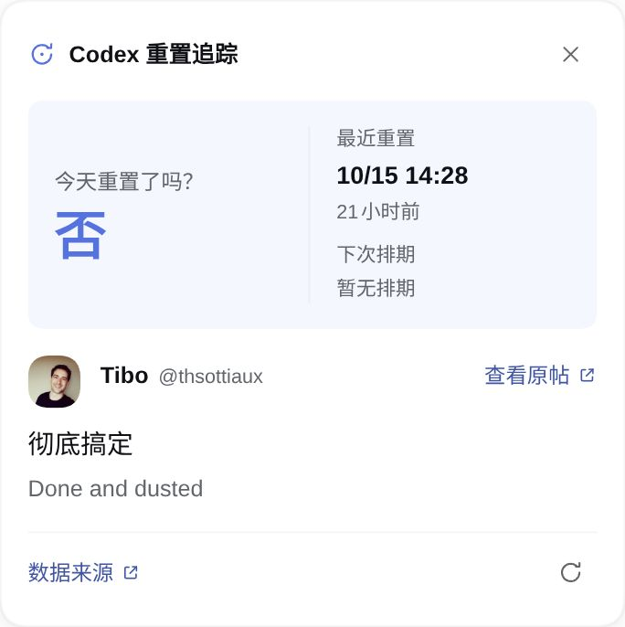
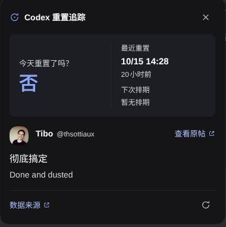

English | [简体中文](README.zh-CN.md)

# dsh-codex-reset-tracker

DeepSeek Harness plugin for Codex reset status. It adds a composer entry with a compact status popover and registers the read-only `codex_reset` agent tool.

## Acknowledgements

Reset signals and available translations are provided by [Did Codex Reset](https://didcodexreset.com/zh/). Thank you to its maintainers for collecting and organizing these public reset signals and providing the [read-only API](https://didcodexreset.com/zh/api.html) and [OpenAPI specification](https://didcodexreset.com/openapi/v1/openapi.json). This repository is a DSH integration of that upstream work; the API does not include account-specific quota information.

Original reset announcements are from [Tibo Sottiaux (@thsottiaux)](https://x.com/thsottiaux).

## Screenshots

| Light theme | Dark theme |
|---|---|
| <a href="assets/screenshot-light.jpg"></a> | <a href="assets/screenshot-dark.jpg"></a> |

## What it shows

- The composer entry reports the source site's live schedule probability (for example, **≥86% Yes**), alongside the latest completed reset and next expected time. The heading switches to an upcoming-reset question when a live schedule is available.
- Schedule confidence comes directly from the public API; it is rounded to a percent as on the source page, with no plugin-defined 80% threshold. A live schedule displays probability + Yes even when its local date is tomorrow. A completion reported today takes priority. Scheduled events remain schedule records and do not replace the latest completed reset. The day check uses the browser's local calendar day; completion times prefer `completedAt`, then `effectiveAt`, then `announcedAt`.
- The popover includes the Tibo Sottiaux source post. It shows the Simplified Chinese translation and the English source when both differ.
- New schedule announcements and completed reset events show an unread marker. The marker clears when the popover is open in a visible tab.
- The client requests `/status` on mount and refreshes every 10 minutes. Opening the popover, returning to the foreground, or reconnecting checks for updates when the snapshot is at least 60 seconds old. Requests time out after 20 seconds and respect rate-limit cooldowns. The popover displays the local time zone and fetch time; fetch time is not the upstream monitor time. The agent tool can query status or paginated records.

## Install from source

Clone the repository, then add it to a DSH profile:

```sh
git clone https://github.com/loshanvren/dsh-codex-reset-tracker.git
cd dsh-codex-reset-tracker
dsh plugin --profile <profile> add .
```

The package and client loader are named `dsh-codex-reset-tracker` as of v0.4.0.

### Upgrade from v0.3.x

The old package was named `dsh-codex-reset`. Remove that package from the same DSH profile before installing the new package, so the old tool and composer entry do not remain enabled alongside the new ones:

```sh
dsh plugin --profile <profile> remove dsh-codex-reset
dsh plugin --profile <profile> add https://github.com/loshanvren/dsh-codex-reset-tracker/releases/latest/download/dsh-codex-reset-tracker.tgz
```

Restart DSH after replacing the package. If you applied the patch manually, change its package `name` to `dsh-codex-reset-tracker`, preserve the `codex-reset` row ID and your `config`, and do not keep a second old row. The unread storage key stays compatible.

### Prebuilt install

```sh
dsh plugin --profile <profile> add https://github.com/loshanvren/dsh-codex-reset-tracker/releases/latest/download/dsh-codex-reset-tracker.tgz
```

The release tarball contains the same JavaScript, manifest, patch and locale files as a source install; there is no install-time build script.

## Agent tool

`codex_reset` supports:

- `action: "status"` — the latest global and Banked reset signals and the next scheduled reset.
- `action: "records"` — one page of records, filtered by `kind`, `page`, and `pageSize`.

The tool accepts an optional `lang` for record translations. Successful responses are cached for 60 seconds by default.

| Config | Default | Purpose |
|---|---:|---|
| `apiBaseUrl` | `https://didcodexreset.com/openapi/v1` | Public API base URL used by the agent tool |
| `cacheTtlSeconds` | `60` | Tool response cache, from 5 to 3600 seconds |
| `timeoutMs` | `20000` | Tool call timeout, from 1000 to 120000 milliseconds |

Override these values under the plugin row's `config` in `cordis.patch.yml`. The public API documents a shared limit of 60 requests per hour per IP.

## License

The MIT License applies to this repository's code only. It does not relicense Did Codex Reset's data or translations, or Tibo Sottiaux's post and profile image.
